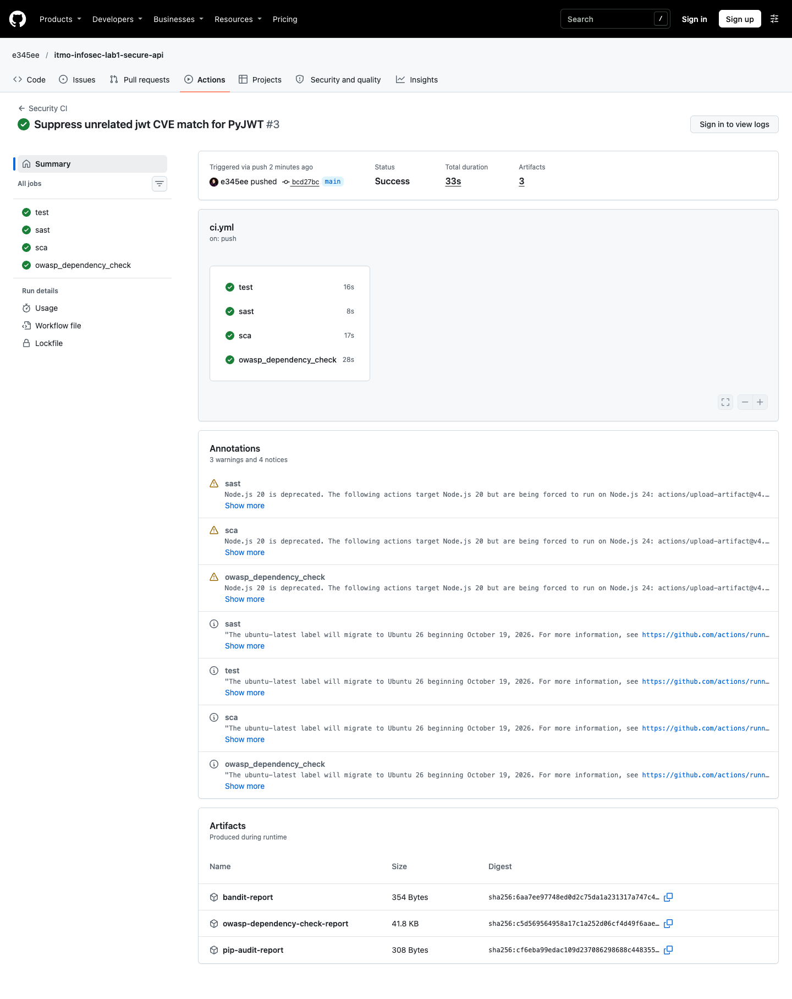
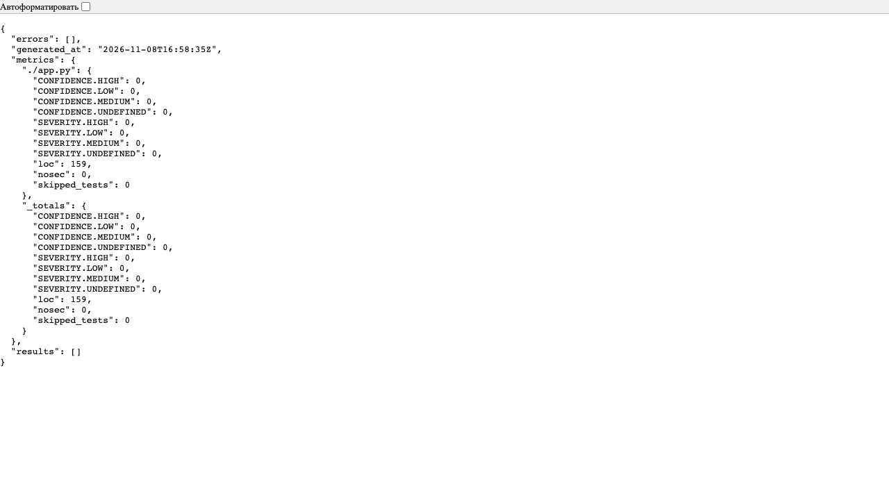
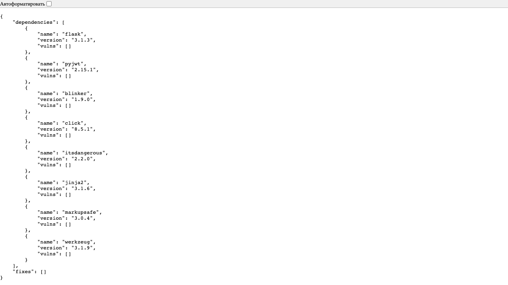
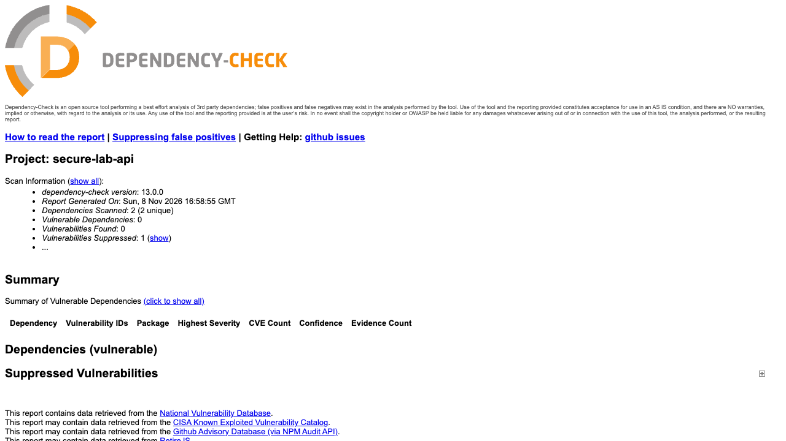

# Информационная безопасность

## Лабораторная работа № 1

### Стек

- Python 3.12, Flask и SQLite.
- PyJWT и Werkzeug.

### Описание API

`POST /auth/register` — регистрация пользователя. Логин состоит из 3–32 латинских букв, цифр или знаков подчёркивания; пароль содержит от 12 до 1024 символов. При успехе возвращает HTTP 201, при занятом логине — HTTP 409.

```json
{"username": "student", "password": "example-password-123"}
```

`POST /auth/login` — аутентификация пользователя по логину и паролю. При успешном входе возвращает JWT.

```json
{"username": "student", "password": "example-password-123"}
```

`GET /api/data` — получение записей пользователя. Требует заголовок `Authorization: Bearer <token>`.

`POST /api/data` — создание записи. Требует тот же заголовок.

```json
{"content": "Пример записи"}
```

### Описание реализованных мер защиты

- **SQLi:** параметризованные запросы SQLite; пользовательские значения передаются отдельно от SQL.
- **XSS:** пользовательский текст экранируется с помощью `html.escape` при выдаче в JSON; используется заголовок `X-Content-Type-Options: nosniff`.
- **Аутентификация:** пароли хэшируются с солью алгоритмом scrypt. JWT подписывается HS256, действует 30 минут и проверяется на защищённых маршрутах. Записи доступны только их владельцу.

```python
user = get_db().execute(
    "SELECT id, password_hash FROM users WHERE username = ?", (username,)
).fetchone()
```

```python
return jsonify(items=[{"id": row["id"], "content": escape(row["content"])} for row in rows])
```

### Отчёты из pipeline

GitHub Actions запускает pytest, Bandit, pip-audit и OWASP Dependency-Check при push и pull request. Отчёты сохраняются как артефакты.








